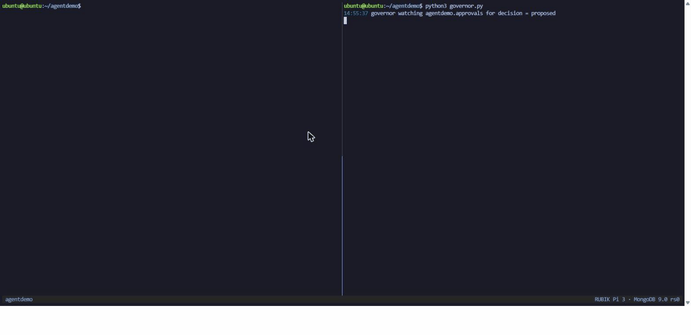

# What Should a Local Agent Remember?

A demo kit and a short lab for using MongoDB as an agent's memory: one document per workflow, indexes derived from the questions the agent asks, change streams instead of polling, TTL for what should expire, and a policy collection that decides what the agent may do. It runs on a single-node replica set, on a laptop with Docker or on a board like the RUBIK Pi 3.

The material comes from a talk by Eoin Jordan, "What Should a Local Agent Remember?". The slides are in `slides/` as a PDF and the one-page summary in `handout/`.

## Quick start

You need Docker (or a MongoDB replica set you already have), `mongosh`, and Python 3 with `pymongo`.

```bash
cd demo
docker compose up -d          # a single-node replica set on localhost:27017
mongosh reset.js              # seed the agentdemo database
./run-demo.sh                 # every demo step with 13 checks; ends "13 passed, 0 failed"
```

Then follow [demo/README.md](demo/README.md) step by step, or start the [lab](lab/README.md).


The change-stream demo: `complete.js` updates the run in one terminal, the consumer in the other receives the event with the full document and resumes the agent.



The guardrails demo: `start_training` is approved by a policy, `deploy_model` is rejected because no policy permits it, and `delete_project` never becomes a document because the schema refuses it. Every decision lands in `audit`.

## Verify

```bash
cd demo && ./run-demo.sh
```

Runs every demo step without a terminal, including the resume-token path and the TTL wait, and checks 13 expected lines. It ends with `13 passed, 0 failed`.

## What is in this repo

| Folder | Contents |
|---|---|
| `demo/` | The demo kit: reset, the first document, the two indexes with `explain()`, the change-stream consumer with a resume token, TTL, the structured query, the policy governor, the resumable agent. `demo/captures/` has the two recordings above. |
| `lab/` | A five-step lab, with a sanitised agent workflow log to start from and a solution for each step. |
| `course-on-pi/` | The MongoDB University "AI Agents with MongoDB" code arranged to run on self-managed MongoDB without paid APIs. |
| `slides/` | The talk as a PDF. |
| `handout/` | The talk on one page. |
| `FAQ.md` | The questions the talk gets, with answers. |
| `RESOURCES.md` | Docs, courses and code behind the talk. |

## Documentation

- [demo/README.md](demo/README.md): every demo step, what it shows, which slide it belongs to.
- [lab/README.md](lab/README.md): the five-step lab.
- [course-on-pi/README.md](course-on-pi/README.md): what was swapped to run the course code without paid APIs.
- [FAQ.md](FAQ.md) and [RESOURCES.md](RESOURCES.md).

## Licence

Code (`demo/`, `lab/`, `course-on-pi/`) is under the Apache License 2.0, see [LICENSE](LICENSE). The slides, the handout and the text are under Creative Commons Attribution 4.0, see [LICENSE-CONTENT](LICENSE-CONTENT). The course code in `course-on-pi/` derives from [mongodb-university/curriculum](https://github.com/mongodb-university/curriculum); the two datasets it loads are MongoDB's, CC BY 3.0.
