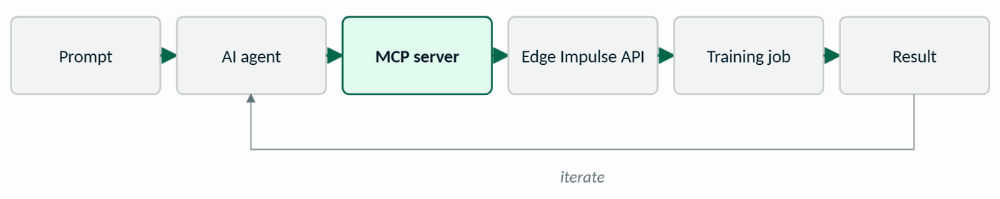
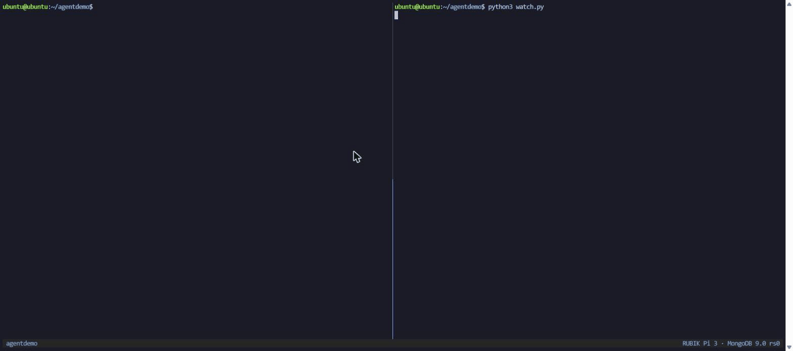

# What Should a Local Agent Remember?

Saving state for agents running at the edge. Slides, demos and a lab from a talk by Eoin Jordan.

The talk: how to use MongoDB to hold short-term and long-term memory for local and remote agentic AI projects, with notes from factory automation, lessons learned, and how to bring the pattern into the systems you already run. Three lines to take away: model for the workload, index for the questions, treat AI memory as data. Everything was shown live on a RUBIK Pi 3 running Ubuntu 24.04 and MongoDB 9.0 Community Edition, with no cloud behind it.



## Start here

| If you want to | Open |
|---|---|
| Read the slides | [slides/what-should-a-local-agent-remember.pdf](slides/what-should-a-local-agent-remember.pdf), or the [web viewer](https://eoinjordan.github.io/what-should-a-local-agent-remember/) |
| Keep one page | [handout/handout.pdf](handout/handout.pdf) |
| Run the demos | [demo/](demo/README.md): one `docker compose up` for the database, then one script per slide |
| Do the 10-minute lab | [lab/](lab/README.md): five steps, starter and solution for each |
| See the questions the talk gets | [FAQ.md](FAQ.md) |
| Go further | [RESOURCES.md](RESOURCES.md) |
| Follow the MongoDB University course on your own hardware | [course-on-pi/](course-on-pi/README.md) |

## Quick start

You need Docker (or a MongoDB replica set you already have), `mongosh`, and Python 3 with `pymongo`.

```bash
cd demo
docker compose up -d          # a single-node replica set on localhost:27017
mongosh reset.js              # seed the agentdemo database
./run-demo.sh                 # every demo step with 13 checks; ends "13 passed, 0 failed"
```

Then follow [demo/README.md](demo/README.md) slide by slide, or start the lab.



The change-stream demo as it ran on the Pi: `complete.js` updates the run in one terminal, the consumer in the other receives the event with the full document and resumes the agent.


The guardrails demo: `start_training` is approved by a policy, `deploy_model` is rejected because no policy permits it, and `delete_project` never becomes a document because the schema refuses it. Every decision lands in `audit`.

## Verify

```bash
cd demo && ./run-demo.sh
```

Runs every demo step without a terminal, including the resume-token path and the TTL wait, and checks 13 expected lines. It ends with `13 passed, 0 failed`.

## What is in this repo

| Folder | Contents |
|---|---|
| `slides/` | The deck as PDF and as .pptx: 23 main slides, 5 hidden capture slides after the live demos, 11 backups. |
| `docs/` | The deck as a single web page, served by GitHub Pages. |
| `handout/` | One printable page. |
| `demo/` | The demo kit: reset, the first document, the two indexes with `explain()`, the change-stream consumer with a resume token, TTL, the structured query, the policy governor, the resumable agent. |
| `lab/` | The five-step lab, with a sanitised agent workflow log to start from. |
| `captures/` | Screenshots and GIFs of each demo step as it ran on the Pi. |
| `course-on-pi/` | The MongoDB University "AI Agents with MongoDB" code arranged to run on self-managed MongoDB without paid APIs. |
| `animations/` | The diagram animations from the slides as HTML and GIF. |
| `video/` | Chapter list of the narrated run-through. The recording is available on request. |


## Documentation

- [Web viewer](https://eoinjordan.github.io/what-should-a-local-agent-remember/): the deck in the browser, built from `docs/index.html`.
- [demo/README.md](demo/README.md): every demo step, slide by slide.
- [lab/README.md](lab/README.md): the five-step lab.
- [FAQ.md](FAQ.md) and [RESOURCES.md](RESOURCES.md).

## Licence

Code (`demo/`, `lab/`, `course-on-pi/`, `animations/`) is under the Apache License 2.0, see [LICENSE](LICENSE). Slides, handout, captures and text are under Creative Commons Attribution 4.0, see [LICENSE-CONTENT](LICENSE-CONTENT). The course code in `course-on-pi/` derives from [mongodb-university/curriculum](https://github.com/mongodb-university/curriculum); the two datasets it loads are MongoDB's, CC BY 3.0.
